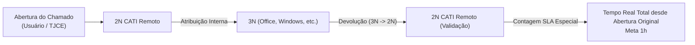

# 📖 Documentação Técnica Completa — Assistente 2N CATI Remoto

> **Extensão Firefox WebExtensions (Manifest V3)**  
> **Público-alvo:** Analistas de Suporte do 2º Nível (2N CATI Remoto) — Tribunal de Justiça do Estado do Ceará (TJCE)  
> **Ambiente Operacional:** `https://cati.tjce.jus.br/assystweb/*` e `https://web.whatsapp.com/*`  
> **Versão:** 3.2.2  
> **Autor:** Pedro Machado  

---

## 📑 Sumário

1. [Visão Geral e Propósito](#1-visão-geral-e-propósito)
2. [Arquitetura de Arquivos da Extensão](#2-arquitetura-de-arquivos-da-extensão)
3. [Módulo 1: Calculadora de SLA — Motor Híbrido (Comercial & 24/7)](#3-módulo-1-calculadora-dinâmica-de-sla)
   - [Lógica de Início do Atendimento no N2](#31-lógica-de-início-do-atendimento-no-n2)
   - [Lógica Especial: Retorno do 3º Nível para Validação](#32-lógica-especial-retorno-do-3º-nível-para-validação)
   - [Contabilização de Múltiplas Pausas e Retomadas](#33-contabilização-de-múltiplas-pausas-e-retomadas)
   - [Regime Comercial vs. Operação 24/7 e Feriados TJCE](#34-cálculo-de-expediente-útil-vs-horário-corrido)
   - [Interface da Caixa Flutuante e Popover com Alternador Rápido](#35-interface-da-caixa-flutuante-e-popover)
   - [Integração com o Relógio Nativo de ANS (Jukebox) & Filtro de Linhas](#36-integração-com-o-relógio-nativo-de-ans-jukebox--filtro-de-linhas)
4. [Módulo 2: Localizador de Atendimentos Programados (Scanner de Fila)](#4-módulo-2-localizador-de-atendimentos-programados-scanner-de-fila)
   - [Visibilidade Condicional do Botão Flutuante](#41-visibilidade-condicional-do-botão-flutuante)
   - [Janela de Agendados Centralizada na Tela](#42-janela-de-agendados-centralizada-na-tela)
   - [Velocidade de Varredura Ajustável](#43-velocidade-de-varredura-ajustável)
   - [Importação e Integração com Lembretes](#44-importação-e-integração-com-lembretes)
5. [Módulo 3: Alertas e Produtividade Operacional (Estilo 1N Sem Bloqueios)](#5-módulo-3-alertas-e-produtividade-operacional-estilo-1n-sem-bloqueios)
   - [Contorno Vermelho em Edifício e Item B](#51-contorno-vermelho-em-edifício-e-item-b)
   - [Lembrete de Base de Conhecimento Não Atribuída](#52-lembrete-de-base-de-conhecimento-não-atribuída)
   - [Alerta de Usuário VIP na Lista Geral](#53-alerta-de-usuário-vip-na-lista-geral)
   - [Botão Copiar Ficha do Chamado](#54-botão-copiar-ficha-do-chamado)
   - [Sincronização com o WhatsApp Web (Ativo e Recentes)](#55-sincronização-com-o-whatsapp-web-ativo-e-recentes)
6. [Módulo 4: Gerenciador de Lembretes e Configurações (Popup)](#6-módulo-4-gerenciador-de-lembretes-e-configurações-popup)
7. [Módulo 5: Modelos de Resposta Rápida e Integração WhatsApp Web](#7-módulo-5-modelos-de-resposta-rápida-e-integração-whatsapp-web)
   - [Barra Lateral Retrátil (Drawer)](#71-barra-lateral-retrátil-drawer)
   - [Card de Chamado Ativo e Histórico de Recentes](#72-card-de-chamado-ativo-e-histórico-de-recentes)
   - [Variáveis Dinâmicas e Substituição Segura](#73-variáveis-dinâmicas-e-substituição-segura)
   - [Categorias e Filtros por Abas](#74-categorias-e-filtros-por-abas)
   - [Editor de Modelos com Chips de Inserção](#75-editor-de-modelos-com-chips-de-inserção)
   - [Inserção Direta no Chat e Prevenção de Injeção](#76-inserção-direta-no-chat-e-prevenção-de-injeção)
8. [Módulo 6: Monitor de Instabilidade e Quedas do Assyst (Downtime Tracker)](#8-módulo-6-monitor-de-instabilidade-e-quedas-do-assyst-downtime-tracker)
   - [Detecção Automática de Quedas e Esgotamento de Licenças](#81-detecção-automática-de-quedas-e-esgotamento-de-licenças)
   - [Cronômetro em Tempo Real e Persistência contra F5](#82-cronômetro-em-tempo-real-e-persistência-contra-f5)
   - [Janela Pós-Login e Comprovante Técnico de SLA](#83-janela-pós-login-e-comprovante-técnico-de-sla)
   - [Painel Diário e Relatório Consolidado para a Gestão](#84-painel-diário-e-relatório-consolidado-para-a-gestão)
9. [Engenharia de Performance e Prevenção de Travamentos](#9-engenharia-de-performance-e-prevenção-de-travamentos)
10. [Procedimentos de Compilação e Instalação](#10-procedimentos-de-compilação-e-instalação)

---

## 1. Visão Geral e Propósito

O **Assistente - 2N CATI Remoto** é uma extensão projetada para elevar a precisão operacional, a produtividade e o controle de SLA dos analistas do 2º Nível de Suporte da CATI (TJCE).

O sistema legado **Assyst (Axios Systems)** não apresenta contadores de SLA em tempo real considerando regras específicas do 2N (como transições entre 2N e 3N, pausas por "Atendimento Programado" ou "Aguardando Info"). Além disso, os analistas precisam monitorar chamados agendados perdidos no meio de dezenas de itens na fila geral e evitar o encerramento de chamados sem base ou com campos críticos em branco (como Edifício e Tombo/Item B).

### Princípios de Design
- **Zero Bloqueios Frustrantes:** Diferente de versões anteriores que impediam salvar (Ctrl+S) ou bloqueavam o fechamento de telas, as validações visuais atuam como guias assertivos sem interromper o fluxo do analista.
- **Isolamento Estrito de Domínio:** A extensão só é injetada e ativada em URLs sob `https://cati.tjce.jus.br/*` e `https://web.whatsapp.com/*`.
- **Vanilla JavaScript Puro:** Sem frameworks pesados (React, Angular, Vue, Webpack), garantindo compatibilidade direta com as bibliotecas Dojo Toolkit/Dijit nativas do Assyst.
- **Operação Reativa e Assíncrona:** Detecção de eventos e rotas SPA sem travamento de renderização da thread principal.

---

## 2. Arquitetura de Arquivos da Extensão

```
assistente-2n-cati-remoto/
├── manifest.json                  # Manifesto V3 com permissões estritas
├── build.py                       # Script de empacotamento .XPI reproduzível
├── README.md                      # Instruções de compilação da Mozilla
├── DOCUMENTACAO.md                # Cópia local desta documentação
├── _locales/
│   ├── pt_BR/messages.json        # Metadados e textos em português
│   └── en/messages.json           # Metadados em inglês
└── src/
    ├── assets/                    # Ícones em todas as resoluções padrão (16 a 128px)
    ├── background/
    │   └── background.js          # Service worker para alarmes e notificações locais
    ├── storage/
    │   └── taskStore.js           # Camada de persistência (chrome.storage.local)
    ├── popup/
    │   ├── popup.html             # Interface gráfica do popup
    │   ├── popup.css              # Estilos do popup e modal de configurações
    │   └── popup.js               # Controlador de lembretes, filtros e ajustes de SLA
    └── content/
        ├── assyst-sla-engine.js   # Novo motor determinístico de cálculo de SLA (Comercial e 24/7)
        ├── assyst-sla.js          # Extrator do DOM Assyst, orquestrador e UI flutuante
        ├── assyst-sla.css         # Estilização da caixa flutuante de SLA e popover
        ├── assyst-downtime.js     # Monitor de instabilidade e quedas do Assyst com cronômetro ao vivo
        ├── assyst-downtime.css    # Estilização do banner de queda e modal de restabelecimento
        ├── assyst-scanner.js      # Scanner da fila geral com paginação e importação
        ├── assyst-scanner.css     # Estilos do botão flutuante e modal de agendados
        ├── assyst-alertas.js      # Validações visuais: Edifício, Item B, Base e VIP
        ├── assyst-alertas.css     # Estilização dos contornos, banners e lembretes
        ├── whatsapp-templates.js  # Gaveta retrátil de modelos no WhatsApp Web
        └── whatsapp-templates.css # Estilos do drawer de mensagens no WhatsApp Web
```

---

## 3. Módulo 1: Calculadora Dinâmica de SLA

O motor de SLA (`assyst-sla.js`) calcula dinamicamente o tempo útil ou corrido decorrido de um chamado, identificando seu ciclo de vida completo através das ações registradas na aba **Ações** do Assyst.

### 3.1 Lógica de Início do Atendimento no N2
O script vasculha a tabela histórica de ações (`gridClasses` do Dojo) e localiza a **primeira ação de "Atribuição Interna"** que destinou o chamado para a equipe do 2º Nível:
- Termos identificadores: `"2N CATI Remoto"`, `"Atendimento 2N Remoto"`, `"2N"`.
- A data e hora dessa primeira atribuição constituem o marco zero (`T0`) do atendimento do analista, ignorando reatribuições internas posteriores entre os próprios técnicos do 2N.

### 3.2 Lógica Especial: Retorno do 3º Nível para Validação
Frequentemente, o 2N encaminha um chamado complexo para uma equipe especialista do 3º Nível (ex: Redes, Banco de Dados, Infraestrutura). Ao concluir, o 3N devolve o chamado para que o 2N valide a solução com o usuário final antes do encerramento.



- **Critério Estrito de Detecção:**
  - Coluna *Nome de Departamento de Serviço de acionamento* contém `"3N"` (ex: `3N CATI Windows`, `3N CATI Office 365`).
  - Coluna *Nome do Departamento de Serviço atribuído* contém expressamente `"2N CATI Remoto"`.
- **Comportamento do Cálculo:**
  - Em vez de zerar o relógio na devolução, o algoritmo resgata a **data de abertura original do chamado no Assyst** (`T_abertura`).
  - O cálculo de estouro ou tempo decorrido reflete o **tempo real total do chamado**, orientando o analista sobre a urgência de fechar a validação ou devolver o chamado para o 3N caso necessário.
  - Na interface, o chamado recebe a etiqueta destacada `• Retorno 3N` e badge `RETORNO 3N (ESTOURADO)` ou `RETORNO 3N (PAUSADO)`.

### 3.3 Contabilização de Múltiplas Pausas e Retomadas
O SLA suporta qualquer quantidade arbitrária de pausas e despausas intercaladas no histórico do chamado:

| Categoria | Ações Reconhecidas | Efeito no SLA |
|---|---|---|
| **Pausa** | `Aguardando Info do Usuário *`, `Atendimento Programado`, `Aguardando Info do Fornecedor`, `Parar Relógio` | Para o relógio. O intervalo entre a data da pausa e a próxima retomada é descartado. |
| **Atendimento Programado** | `Atendimento Programado` com data/hora em `remarks` | Pausa a contagem e reativa automaticamente o relógio na data/hora marcada (`materializeSchedule`). |
| **Retomada / Despausa** | `Info Recebidas do Usuário *`, `Info Recebida do Fornecedor`, `Iniciar Relógio *`, retorno de 3N (`3N TJ*`), respostas via portal (`assystNet User`) | Reativa a contagem do SLA a partir do exato instante da ação de retomada ou despausa automática. |
| **Ações Internas** | `Atribuição Interna` (entre técnicos do 2N), notas técnicas, anexos | Se o chamado estava pausado, permanece pausado até a ação de retomada. |
| **Fechamento / Reabertura** | `Resolvido`, `Fechamento`, `Reabrir` | Encerra a contagem ou religa o relógio em caso de reabertura. |

### 3.4 Regime Comercial vs. Operação 24/7 e Feriados Oficiais
Configurável via Popup (`agenda_settings`) ou diretamente pelo popover da caixa flutuante:
- **Modo Horário Comercial (Padrão 2N Remoto):**
  - Contabiliza estritamente os minutos transcorridos dentro da janela útil definida (padrão: **08:00 às 18:00**), de segunda a sexta-feira.
  - Noites, madrugadas, finais de semana e feriados oficiais da Justiça Estadual (TJCE/CE) **não consomem minutos de SLA**.
  - **Status Fora de Expediente:** Chamados recebidos ou auditados fora do horário comercial exibem o ícone `🌙` e status `🌙 Fora de Expediente • Inicia 08:00`, congelando o relógio e projetando a retomada no próximo dia útil.
- **Modo Operação 24/7 (Tempo Corrido):**
  - Contabilização contínua e ininterrupta (00:00 às 23:59), sem pausas por noites, fins de semana ou feriados.
  - Desenvolvido especificamente para as equipes de plantão 24/7 da CATI.
- **Tabela de Trechos Computados (`dayRows`):**
  - O motor expõe a lista discriminada de cada dia e faixa horária útil calculada (ex.: `10/08 08:00 às 18:00 (600 min)`), proporcionando total transparência ao analista.

### 3.5 Interface da Caixa Flutuante e Popover
- **Localização:** Fixada no canto inferior esquerdo da tela (`bottom: 24px; left: 68px`).
- **Dimensões e Escala Configurável:**
  - **Ajuste nas Configurações:** O analista pode selecionar escalas de 75% a 140% no menu de opções do Assistente.
  - **Ajuste Rápido no Popover:** Botões `[-]` e `[+]` na barra inferior do popover da própria caixa permitem redimensionar em tempo real (+/- 10%) sem precisar abrir as configurações.
  - **CSS Dinâmico Sharp:** Usa variável `--sla-scale` combinada com `calc(...)` nativo, mantendo a nitidez perfeita das fontes e proporções sem distorções de renderização.
- **Estados Visuais (Cores e Ícones):**
  - 🟢 **Verde (`status-ok`):** Dentro do prazo estipulado.
  - 🔵 **Azul / ⚡ (`status-running`):** Em andamento ativo (ícone ⚡ no modo 24/7).
  - 🟡 **Âmbar (`status-paused`):** Atualmente pausado sob ação interna (ex: aguardando usuário).
  - 🌙 **Noturno (`status-paused`):** Fora do expediente comercial (relógio congelado até as 08:00).
  - 🔴 **Vermelho Pulsante (`status-violated`):** SLA estourado / violado.
- **Alternador Rápido de Regime:**
  - Card dedicado no topo do popover exibindo o regime ativo (`☀️ Horário Comercial` vs `⚡ Operação 24/7`) e botão instantâneo de alternância (`Mudar p/ 24/7` / `Mudar p/ Comercial`), com atualização reativa e imediata no Assyst.
- **Acionamento Manual Dentro do Chamado:** Ao abrir os detalhes de um chamado, o Assistente não calcula o SLA automaticamente nem desce a tela para o histórico de ações. A caixa flutuante fica em estado de prontidão (`⏱️ SLA [ID]: Calcular`), aguardando o clique manual do analista na caixa flutuante para ler as ações e calcular o SLA com preservação automática da posição de scroll da tela.
- **Popover Hover:** Ao passar o mouse sobre a caixa flutuante, abre-se para cima um painel detalhado contendo:
  - Regime de Trabalho ativo com botão de alternância rápida.
  - Alerta de Fora de Expediente (quando aplicável).
  - Fluxo de Retorno do 3º Nível (quando aplicável).
  - Início da contagem / Abertura original.
  - Tempo líquido contabilizado e prazo restante / estouro.
  - Meta de SLA e status atual.
  - Estado do Relógio Nativo de ANS do Assyst (Jukebox).
  - Tabela com os trechos diários calculados (`dayRows`).
  - Histórico de eventos de pausa / reativação / agendamento.
  - Botão 🔄 para forçar recálculo instantâneo.
  - Barra de ajuste de tamanho com indicação percentual instantânea.

### 3.6 Integração com o Relógio Nativo de ANS (Jukebox) & Filtro de Linhas
- **Detecção do Relógio Oficial:** O Assyst possui o componente `#jukeboxSlaClock` (`.jukeboxSlaClockStoppedIcon`) com o título oficial `"Relógio de ANS parado"`. A extensão lê esse elemento como confirmação em tempo real e exibe o estado oficial dentro do popover.
- **Prevenção de Falso Positivo na Fila:** Na tela de busca/fila (`#eventsearch...`), as linhas da grade geral contêm o número do chamado na primeira coluna. Foi implementado um filtro estrito regex (`/^[A-Za-z]{0,3}\d{5,10}$/`) que descarta as linhas da grade geral, evitando que a data de registro de outros chamados da lista polua o histórico de ações.

---

## 4. Módulo 2: Localizador de Atendimentos Programados (Scanner de Fila)

O localizador (`assyst-scanner.js`) automatiza a varredura da fila geral do 2N em busca de chamados cujo status ou última ação seja **"Atendimento Programado"**.

### 4.1 Visibilidade Condicional do Botão Flutuante
- O botão flutuante **"Localizar Agendados (2N)"** (`#cati-floating-trigger`) fica fixado na extremidade inferior direita (`bottom: 24px; right: 24px`).
- **Comportamento Inteligente:** Aparece **exclusivamente quando o analista está na lista/fila geral de chamados** (`#eventsearch...` ou tabela de eventos). Quando o analista abre um chamado (`DisplayEvent.do` ou formulário de evento), o botão é automaticamente ocultado (`display: none`) para não poluir o espaço de trabalho.

### 4.2 Janela de Agendados Centralizada na Tela
- O painel modal (`.cati-overlay-panel`) é centralizado na tela (`top: 50%; left: 50%; transform: translate(-50%, -50%);`) com sombra ampla e efeito de profundidade.
- **Desobstrução do Alerta VIP:** Garante que a faixa vermelha de Alerta de Usuário VIP (`.cati-vip-banner` no topo da tela) permaneça 100% visível e legível enquanto a janela de agendados estiver aberta.

### 4.3 Velocidade de Varredura Ajustável
- O analista pode ajustar o ritmo da varredura de acordo com a velocidade da sua conexão ou do servidor do Assyst:
  - ⚡ **Turbo** (~0.3s por chamado): Para conexões rápidas e análise instantânea.
  - 🚀 **Rápida** (~0.5s por chamado): Alta agilidade com boa tolerância.
  - ⚖️ **Normal (Padrão)** (~0.8s por chamado): Equilíbrio ideal entre rapidez e estabilidade.
  - 🐢 **Moderada** (~1.2s por chamado): Recomendado quando o Assyst estiver instável.
  - 🛑 **Lenta** (~2.0s por chamado): Para conexões lentas, garantindo que cada tela carregue totalmente.
- **Controle Flexível:** Pode ser ajustado nas preferências da extensão (Popup) ou diretamente no cabeçalho da própria janela de varredura.

### 4.4 Importação e Integração com Lembretes
- Os analistas podem marcar os chamados desejados com checkboxes ou clicar em **"Importar Selecionados"**.
- Os agendamentos são gravados diretamente no armazenamento local da extensão com alarme configurado. No horário programado, o navegador emite uma notificação sonora e visual com o link direto para o chamado.

### 4.5 Scanner de Chamados Aguardando Info há 7+ Dias
- **Ativação Universal na Fila:** O botão flutuante `#cati-floating-trigger-waiting-info` (**"Aguardando Info (7+ Dias)"**) aparece no canto inferior direito em qualquer lista, pesquisa ou fila de chamados do Assyst, permitindo verificar os chamados pausados de qualquer equipe ou pesquisa personalizada. Pode ser recolhido a qualquer momento pelo menu de hambúrguer.
- **Regra de Negócio (Encerramento por Inatividade):** Conforme regulamento do suporte, o analista deve aguardar até 7 dias por retorno do usuário após pausar por "Aguardando Info do Usuário". No 7º dia sem resposta, o chamado pode ser concluído como resolvido.
- **Equipe Configurável nas Preferências:** Por padrão, a extensão valida se a pausa foi realizada por técnico da equipe **"2N CATI Remoto"** (coluna *Nome de Departamento de Serviço de acionamento*). Nas configurações da extensão (Popup), o campo **"Equipe de Verificação (Aguardando Info)"** permite alterar o nome da equipe conforme a necessidade do setor, mantendo total flexibilidade para outras equipes ou divisões de atendimento.
- **Painel de Resultados:** Exibe modal moderno listando os chamados aptos com a contagem exata de dias decorridos (ex.: 8 dias, 12 dias), botão **"Abrir no Assyst"** (abrindo o chamado em nova guia) e botão **"Copiar Lista de Chamados"**.

### 4.6 Paginação Dinâmica da Grade do Assyst e Alerta de Alto Volume
- **Detecção Inteligente do Paginador:** O scanner lê automaticamente a opção de tamanho de página ativa no Assyst através do elemento:
  `table.dojoxGridPaginator > tbody > tr > td > div.sizeSwitchDiv > span.dojoxGridActivedSwitch`
  Identificando valores como `25`, `50`, `100` ou `Todos`.
- **Adaptação Automática do Limite:** O Localizar Agendados e o Aguardando Info ajustam dinamicamente a quantidade de registros inspecionados para corresponder com a visão selecionada na grade.
- **Alerta de Alto Volume:** Quando o filtro ativo for `100` ou `Todos`, o assistente exibe um alerta visual no corpo da janela de progresso (`.cati-volume-alert`) e emite uma notificação toast no Assyst avisando que a verificação completa pode demorar um pouco mais, garantindo previsibilidade ao analista.

---

## 5. Módulo 3: Alertas e Validações Visuais (Estilo 1N Sem Bloqueios)

O módulo `assyst-alertas.js` reproduz as sinalizações consagradas da extensão do 1N, com a premissa fundamental de **nunca bloquear o trabalho do analista**.

### 5.1 Contorno Vermelho em Edifício e Item B
Quando o analista está dentro do formulário de um chamado:
- **Campo Edifício:**
  - Monitora inputs com terminação `_building_textNode` ou `name="building.text"`.
  - Se o campo estiver vazio ou com o valor padrão do Assyst (`"Por Definir"`), o container do campo recebe a classe CSS `.cati-campo-pendente`.
  - Efeito: Borda vermelha sólida de 3px (`#E53935`) e sombra com brilho de alerta (`box-shadow: 0 0 8px rgba(229, 57, 53, 0.45)`).
- **Campo Item B (Tombo / Número de Série):**
  - Monitora inputs com terminação `_itemB_textNode` ou `name="itemB.text"`.
  - Conforme definido para o 2N: **sempre que o Item B estiver vazio ou "Por Definir"**, aplica o contorno vermelho, alertando visualmente para o preenchimento.
  - Assim que o analista digita ou seleciona uma opção no Dojo combobox, o contorno desaparece instantaneamente.
  - **Zero Bloqueios:** O analista continua podendo salvar (Ctrl+S) ou despachar normalmente.

### 5.2 Lembrete de Base de Conhecimento Não Atribuída
- O script avalia o elemento `#jukeboxKnowledgeContent` na lateral do chamado.
- Se o conteúdo textual estiver vazio (nenhuma base de conhecimento indexada ao atendimento), insere um banner no topo da área de ações (`#jukeboxsuggestedactionscontent`):
  ```html
  <div id="cati-notificacao-sem-base" class="cati-lembrete-sem-base">
    ⚠️ SEM BASE ATRIBUÍDA ⚠️
  </div>
  ```
- O banner pulsa suavemente em vermelho claro e vermelho escuro.
- O botão de encerramento (`CLOSURE`) **não é desabilitado**, permitindo a resolução livre caso a base precise ser preenchida posteriormente.

### 5.3 Alerta de Usuário VIP na Lista Geral
- Ativo **apenas na lista geral de chamados**.
- Detecta linhas que contenham o ícone de chamado VIP (`.baseGridImage.alert-red`) ou linhas selecionadas cuja visualização contenha o texto `"USUÁRIO VIP"`.
- Renderiza no canto superior direito (`top: 70px; right: 24px`) um badge pulsante:
  `🚨 USUÁRIO VIP IDENTIFICADO: Chamado 2148674`
- Garante que analistas priorizem imediatamente atendimentos direcionados a magistrados, diretores ou setores estratégicos.

### 5.4 Botão Flutuante Copiar Ficha do Chamado
Exibido exclusivamente quando o analista estiver dentro de um chamado, posicionado como botão flutuante logo acima da caixa de SLA no canto inferior esquerdo (`bottom: 70px; left: 24px`):
- **Botão `[📋 Copiar Ficha]`:**
  - Preserva o cabeçalho original do Assyst 100% limpo e sem quebrar botões nativos do sistema.
  - Alinhado dinamicamente acima da caixa flutuante de SLA.
  - Ao ser clicado, captura automaticamente os dados estruturados do atendimento aberto:
    - **Número do chamado** (com prefixo `#`).
    - **Usuário afetado** (com matrícula sanitizada).
    - **Lotação / Seção** do servidor/magistrado.
    - **Telefone** de contato.
    - **Item de serviço** e **Resumo**.
  - Formata no padrão legível com emojis:
    ```text
    📌 Chamado: #2148674
    👤 Usuário: BEATRIZ VITORINO MELO LIMA
    🏢 Lotação: SECRETARIA DE GOVERNANÇA INSTITUCIONAL
    📞 Contato: 85992102605
    💻 Item: Serviço de e-mail
    📝 Resumo: Serviço de e-mail-Erro/Falha
    ```
  - Copia para o clipboard e exibe confirmação visual `✓ Ficha Copiada!`.
  - Desaparece automaticamente ao navegar para a fila geral de chamados.

### 5.5 Sincronização com o WhatsApp Web (Ativo e Recentes)
O script `assyst-alertas.js` mantém uma ponte de sincronização transparente com o WhatsApp Web:
- **Extração Resiliente de Chamado e Assunto:**
  - Extrai o número do chamado da aba do Dojo ativa ou do elemento de cabeçalho (`#contentPaneTitle`).
  - Extrai o assunto com prioridade no campo **Item de Configuração** (`dijit_form_FilteringSelect`) e fallback no **Resumo** (`#dijit_form_ValidationTextBox_0`), descartando valores sentinelas ou campos vazios.
- **Armazenamento Reativo:**
  - `cati_active_ticket`: Objeto `{ chamado, assunto, timestamp }` atualizado a cada novo chamado aberto.
  - `cati_recent_tickets`: Histórico em lista contendo até 5 chamados recentes, permitindo troca rápida de contexto.
- **Suporte Multi-Abas:**
  - Ouvintes de `focus` e `blur` da janela limpam o cache de sincronização, garantindo que a alternância entre abas de chamados no Assyst atualize imediatamente o chamado ativo no `chrome.storage.local`.

### 5.6 Menu Hambúrguer e Toggle de Visibilidade dos Botões (Pablo)
Para otimizar o espaço em tela (especialmente em notebooks e monitores menores), um botão de controle unificado gerencia todos os elementos flutuantes do Assyst:
- **Botão Toggle `#cati-assyst-menu-toggle` (`[ ☰ ]`):**
  - Posicionado discretamente no canto inferior esquerdo (`bottom: 24px; left: 24px;`).
  - **Modo Minimizado:** Com 1 clique ou via atalho de teclado `Alt + M`, recolhe todos os botões flutuantes da tela (`#cati-sla-floating-trigger`, `#cati-btn-copiar-ficha`, `#cati-floating-trigger`, `#cati-floating-trigger-waiting-info`), exibindo apenas uma pílula compacta `[ ☰ CATI ● ]`.
  - **Indicador Dinâmico de SLA:** Mesmo no modo minimizado, exibe um ponto colorido (`●`) indicando em tempo real a saúde do chamado ativo:
    - 🟢 Verde: SLA dentro do prazo.
    - 🔴 Vermelho: SLA violado/estourado.
    - 🟡 Amarelo: SLA pausado.
    - 🔵 Azul: Em andamento normal.
  - **Persistência de Preferência:** Armazena o estado minimizado em `chrome.storage.local` (`cati_assyst_buttons_minimized`), preservando a escolha do analista entre sessões e trocas de abas.
  - **Atalho de Teclado:** Pressione `Alt + M` a qualquer momento para alternar instantaneamente entre a visualização limpa e expandida.

---

## 6. Módulo 4: Gerenciador de Lembretes e Configurações (Popup)

Acessível através do ícone da extensão na barra de ferramentas do Firefox:

- **Lista de Tarefas e Lembretes:**
  - Visualizações: *Todos*, *Hoje*, *Amanhã*, *Vencidos*, *Concluídos*.
  - Lembretes com prioridade (*Alta*, *Normal*, *Baixa*), tags e subtarefas.
  - Botão de adiamento rápido (*Snooze* configurável).
- **Painel de Configurações de SLA e Atendimento:**
  - **Meta de SLA (horas):** Padrão de 1 hora para o 2N Remoto (ajustável).
  - **Modo de Contagem:** *Expediente Útil Comercial* (fixo 08:00 às 18:00 com pausas regulamentares) ou *Tempo Corrido (24/7)* ininterrupto.
  - **Tamanho da Caixa Flutuante:** Escala visual configurável (70% a 160%).
  - Sincronização automática imediata com a interface do Assyst sem precisar recarregar a página.

---

## 7. Módulo 5: Modelos de Resposta Rápida e Integração WhatsApp Web

Injetado automaticamente ao acessar o WhatsApp Web (`https://web.whatsapp.com/`):

### 7.1 Barra Lateral Retrátil (Drawer) e Botão Flutuante (Shansheel)
- **Aba Flutuante e Arrastável (`#cati-wa-trigger-btn`):**
  - Posicionada na borda direita da tela (`💬 Modelos CATI`), com grip visual (`⋮⋮`).
  - **Arraste Vertical (Drag & Drop):** Permite clicar e arrastar a aba para cima ou para baixo pelo eixo vertical, evitando cobrir balões de mensagens, horários ou dados que o analista precise selecionar e copiar.
  - **Memória de Posição:** A coordenada vertical (`top %`) é persistida em `chrome.storage.local` (`cati_wa_trigger_top`) e restaurada automaticamente ao recarregar o WhatsApp.
  - **Modo Minimizado / Compacto:** Botão toggle `›` recolhe a aba em um mini ícone (`💬`), ocupando espaço visual mínimo.
- **Gaveta Deslizante:** Exibe a relação de modelos de atendimento com visual moderno, suporte automático ao Modo Escuro nativo do WhatsApp Web e fechamento rápido via tecla `ESC` ou clique fora.

### 7.2 Card de Chamado Ativo e Histórico de Recentes
- **Sincronização em Tempo Real:** Conectado ao `chrome.storage.local`, reflete automaticamente o chamado aberto no Assyst.
- **Badge de Origem:** Exibe indicador visual de proveniência dos dados:
  - `🟢 Assyst`: Dados extraídos automaticamente da aba ativa do Assyst.
  - `⚪ Manual`: Dados editados ou inseridos manualmente pelo analista diretamente no card.
- **Edição em Tempo Real e Limpeza:**
  - Inputs `#cati-wa-ticket-num` e `#cati-wa-ticket-subject` permitem ajustar os valores na hora.
  - Botão `✕ Limpar`: Reseta o chamado ativo e desmarca os chips.
- **Histórico dos Últimos Chamados (Chips Rápidos):**
  - Barra horizontal de chips `#cati-wa-recent-tickets-chips` com os últimos chamados acessados no Assyst.
  - Alternância com 1 clique: selecionar um chip atualiza instantaneamente o contexto de variáveis e destaca visualmente o chip ativo.

### 7.3 Variáveis Dinâmicas e Substituição Segura
Os modelos suportam marcadores especiais substituídos dinamicamente no momento da inserção ou cópia:
- **`{saudacao}`**: Detecta a hora local do sistema:
  - Antes das 12:00: substitui por `"Bom dia"`.
  - A partir das 12:00: substitui por `"Boa tarde"`.
- **`{chamado}`**: Substitui pelo número do chamado ativo (ex: `2148674`). Se nenhum chamado estiver carregado, utiliza o fallback `[Nº CHAMADO]`.
- **`{assunto}`**: Substitui pelo assunto/item do chamado ativo. Se indisponível, utiliza o fallback `[ASSUNTO]`.
- **Substituição Segura:** Regex executado com callback `() => valor`, protegendo o texto contra corrupção acidental por caracteres de substituição do JavaScript (como `$1` ou `$&` comuns em descrições de erros ou valores monetários).

### 7.4 Categorias e Filtros por Abas
- **Abas de Filtragem:** Filtro rápido por pílulas no topo da gaveta:
  - `Todos` (exibe o catálogo completo)
  - `Primeiro Contato` (início de atendimento e saudação)
  - `Acompanhamento` (solicitação de dados ou verificação de testes)
  - `Encerramento` (validação e encerramento com sucesso)
  - `Geral` (recados diversos e orientações)
- **Badges Visuais:** Cada card de modelo exibe uma etiqueta colorida correspondente à sua categoria.
- **Busca Combinada:** O campo de busca pesquisa no título e texto do modelo respeitando a categoria ativa.

### 7.5 Editor de Modelos com Chips de Inserção
- **Formulário Integrado:** Criação e edição de modelos com campos de Título, Categoria e Texto.
- **Chips de Atalho de Variáveis:**
  - Botões rápidos `+ {saudacao}`, `+ {chamado}` e `+ {assunto}` no rodapé da caixa de texto.
  - Inserção precisa na posição atual do cursor (`selectionStart`), preservando o foco e permitindo montar mensagens ricas sem digitação manual de chaves.

### 7.6 Inserção Direta no Chat e Prevenção de Injeção
- **Botão `[💬 Inserir no Chat]`:**
  - Localiza o campo de digitação da conversa ativa (`footer div[contenteditable='true']`).
  - Resolve todas as variáveis dinâmicas e insere o texto utilizando a engine de texto do WhatsApp Web (Lexical / Draft.js).
  - Mantém o foco no chat para que o analista possa complementar o texto ou pressionar Enter.
  - Copia paralelamente para a área de transferência como contingência e exibe confirmação visual `✓ Inserido no chat do WhatsApp!`.
- **Botão `[📋 Copiar]`:** Resolve variáveis e copia para o clipboard com notificação visual.
- **Prevenção de XSS:** Função utilitária `escapeHtml()` sanitiza strings no card sem comprometer caracteres literais na inserção do chat.

---

## 8. Módulo 6: Monitor de Instabilidade e Quedas do Assyst (Downtime Tracker)

O **Downtime Tracker** cataloga automaticamente os períodos em que o Assyst cai ou impede o acesso dos analistas (sessões expiradas repentinamente, esgotamento do pool de licenças ou instabilidades de rede e servidor), fornecendo comprovação técnica imediata para justificar estouros de SLA e relatórios consolidados para a supervisão.

### 8.1 Detecção Automática de Quedas e Esgotamento de Licenças
O script monitora rotas e assinaturas de erro do Assyst em tempo de execução:
1. **Queda de Sessão:** URL de logout com parâmetro `sessionInvalid=true` (`/assystweb/logout/logout.do?dispatch=prepare&sessionInvalid=true...`) e presença do texto *"Você saiu do aplicativo do assyst. / Sua sessão expirou."*.
2. **Esgotamento de Licenças:** Bloqueio no login com aviso literal *"Todas as licenças estão em uso. Tente novamente mais tarde."*.
3. **Instabilidades HTTP / Rede:** Erros 500, 502, 503 e 504 (*Bad Gateway*, *Service Unavailable*, *Gateway Timeout*).

### 8.2 Cronômetro em Tempo Real e Persistência contra F5
- **Início Imediato:** Ao detectar a indisponibilidade, o assistente grava o início do incidente em `chrome.storage.local` sob a chave `cati_downtime_active`.
- **Resiliência a F5:** O timestamp original (`inicio`) é preservado. Se o analista recarregar a página ou clicar no link *"Voltar à página principal"*, o cronômetro continua de onde estava sem reiniciar a contagem.
- **Card Fixo na Tela:** Banner âmbar escuro (`#cati-downtime-banner`) no topo da tela com cronômetro ao vivo em segundos (`#cati-downtime-chrono`), tag do diagnóstico (`[Sessão Expirada]` ou `[Falta de Licenças]`) e orientações.

### 8.3 Janela Pós-Login e Comprovante Técnico de SLA
Ao restabelecer a conexão (redirecionamento com sucesso para `application.do` com interface autenticada), o assistente:
1. Finaliza o incidente e arquiva no histórico (armazenando até 30 ocorrências em rotação FIFO).
2. Exibe imediatamente a janela/modal verde de celebração (`#cati-downtime-modal-restabelecido`) informando o tempo total fora do ar e o intervalo de horário.
3. Disponibiliza o botão **`[📋 Copiar Comprovante de SLA]`**, que gera o texto técnico formatado pronto para anexar na justificativa de estouro de ANS:

```text
⚠️ COMPROVANTE DE INSTABILIDADE DO SISTEMA (ASSYST)
📅 Data: 16/10/2026
⏱️ Início da Queda: 14:10:22
🔄 Restabelecimento: 14:28:45
⏳ Duração da Indisponibilidade: 18 minutos e 23 segundos
📌 Diagnóstico: Sessão Expirada / Falta de Licenças no Servidor
🏢 Equipe: 2N CATI Remoto — TJCE
ℹ️ Registro autenticado pelo Assistente 2N CATI Remoto
```

### 8.4 Painel Diário e Relatório Consolidado para a Gestão
No popup da extensão:
- **Card Quedas do Assyst (`#cati-downtime-section`):** Exibe contadores do dia em tempo real (*"Hoje: X quedas • Total: Y min"*).
- **Lista de Ocorrências:** Detalhamento cronológico das quedas registradas na data.
- **Botão `[📊 Copiar Relatório]`:** Gera o relatório consolidado diário para envio à supervisão e coordenação:

```text
📊 RELATÓRIO DE INSTABILIDADE DO ASSYST — TJCE
📅 Data: 16/10/2026
🏢 Equipe: 2N CATI Remoto
--------------------------------------------------
• Queda 1: 09:14:10 às 09:25:20 (11 min e 10 seg) — Sessão Expirada
• Queda 2: 11:30:05 às 11:42:15 (12 min e 10 seg) — Todas as licenças em uso
• Queda 3: 14:10:22 às 14:28:45 (18 min e 23 seg) — Sessão Expirada
--------------------------------------------------
⏱️ Tempo Total de Indisponibilidade: 41 minutos e 43 segundos
🔢 Total de Ocorrências: 3 quedas
ℹ️ Dados catalogados automaticamente pelo Assistente 2N CATI Remoto
```

---

## 9. Engenharia de Performance e Prevenção de Travamentos

O Assyst é uma aplicação web rica baseada em Dojo Toolkit que manipula intensamente o DOM durante o carregamento de telas (especialmente ao abrir um evento via `DisplayEvent.do`, onde milhares de nós HTML são gerados simultaneamente).

### Otimizações Implementadas
1. **Debounce Centralizado:** Todos os observers utilizam temporizadores (`agendarVerificacoes(300)`). Centenas de inserções em lote resultam em apenas uma execução.
2. **Remoção de Filtros de Classe:** O observer monitora apenas adições/remoções estruturais (`childList: true`), nunca mutações no atributo `class`.
3. **Guarda de Escrita no DOM:** Antes de aplicar qualquer classe (`classList.add("cati-campo-pendente")`) ou alterar o texto do banner VIP, o script verifica se o elemento já possui aquele estado. Se não houver alteração real, o DOM permanece intocado.
4. **Isolamento de Escopo:** Na fila geral, o script não busca campos de formulário. Dentro de um chamado, não escaneia a grade em busca de VIPs.

---

## 10. Procedimentos de Compilação e Instalação

### Compilação do Pacote (.XPI)
O script Python reproduzível `build.py` empacota a extensão respeitando a hierarquia exigida pelo Firefox:

```bash
cd /home/ubuntu/projeto-2n/assistente-2n-cati-remoto
python3 build.py
```
Isso gera o arquivo `assistente-2n-cati-remoto.xpi`.

### Instalação no Mozilla Firefox
1. Abra o Firefox e digite na barra de endereços: `about:debugging#/runtime/this-firefox`
2. Clique no botão **"Carregar extensão temporária..."** (Load Temporary Add-on).
3. Selecione o arquivo `manifest.json` da pasta `assistente-2n-cati-remoto/` ou o arquivo `assistente-2n-cati-remoto.xpi`.
4. A extensão será carregada imediatamente e estará pronta para uso nas abas do Assyst (`https://cati.tjce.jus.br/*`).
