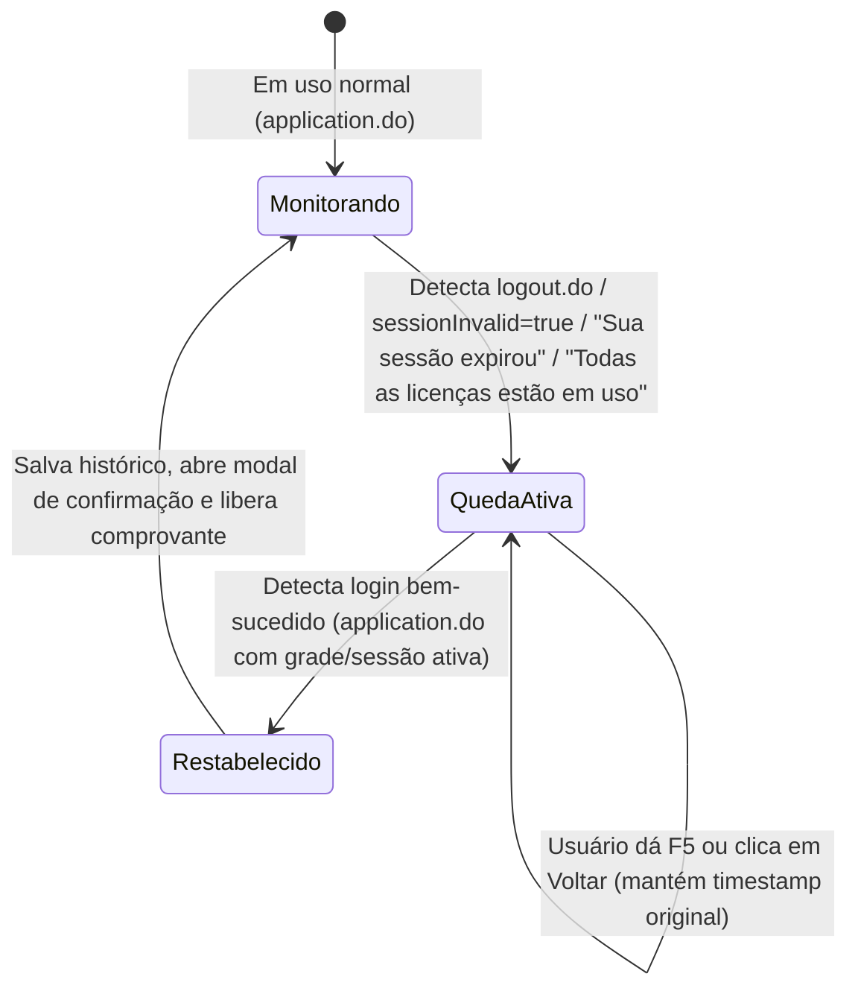

# Especificação Técnica: Monitor de Instabilidade e Quedas do Assyst (Downtime Tracker)

> **Projeto:** Assistente 2N CATI Remoto  
> **Data:** 16 de Outubro de 2026  
> **Status:** Aprovado em Brainstorming  
> **Ambiente:** `https://cati.tjce.jus.br/assystweb/*` (TJCE)  

---

## 1. Visão Geral e Justificativa

O sistema **Assyst (Axios Systems)** sofre quedas recorrentes ao longo do dia no ambiente de produção do TJCE, manifestando-se por:
1. Expulsão repentina de sessão (`sessionInvalid=true` e `"Sua sessão expirou."`).
2. Bloqueio no login por esgotamento de licenças (`"Todas as licenças estão em uso. Tente novamente mais tarde."`).
3. Instabilidades gerais de rede e servidor (erros 500/502/503/timeout).

### Objetivos:
- **Automatizar a Catalogação:** Iniciar cronômetro imediato assim que a queda for detectada, preservando a contagem mesmo com recarregamento da página (F5) ou cliques em "Voltar".
- **Comprovação de SLA:** Ao restabelecer a conexão (login concluído), exibir janela com o tempo total fora do ar e botão de 1 clique para copiar o texto técnico de justificativa de estouro de SLA.
- **Relatório para a Gestão:** Consolidar no popup da extensão o histórico das quedas do dia com cálculo de tempo acumulado e botão para exportar relatório completo para a supervisão.

---

## 2. Arquitetura e Novos Arquivos

A funcionalidade será implementada seguindo a **Abordagem 1** (módulo desacoplado):

```
assistente-2n-cati-remoto/
├── manifest.json                  # Registro de assyst-downtime.js e assyst-downtime.css
└── src/
    ├── content/
    │   ├── assyst-downtime.js     # Detector de rotas de queda, cronômetro e restabelecimento
    │   └── assyst-downtime.css    # Estilização do card flutuante na tela de login e modal de restabelecimento
    └── popup/
        ├── popup.html             # Adição da seção "Quedas do Assyst"
        ├── popup.css              # Estilos do card de resumo e lista de incidentes
        └── popup.js               # Renderização do histórico e cópia do relatório consolidado
```

---

## 3. Máquina de Estados e Lógica de Detecção



### 3.1 Critérios Determinísticos de Queda:
Uma queda é registrada se qualquer uma das condições abaixo for atendida:
- A URL contiver `/logout/logout.do` e `sessionInvalid=true`.
- O corpo da página contiver o texto literal `"Sua sessão expirou."`.
- O corpo da página contiver o texto literal `"Todas as licenças estão em uso"`.
- Ocorrer página de erro com status HTTP 500, 502, 503 ou 504.

### 3.2 Critérios de Restabelecimento:
O sistema é considerado recuperado quando:
- A URL for a aplicação principal (`/application.do`).
- Não houver mais parâmetros de `logout.do` nem mensagens de erro de licença/sessão.
- Houver elementos de interface autenticada carregados no DOM (como `#contentPaneTitle`, `.dijitTab`, grade de chamados ou `#banner_user_info`).

---

## 4. Esquema de Dados (`chrome.storage.local`)

### 4.1 Incidente Ativo (`cati_downtime_active`):
```json
{
  "id": "down_1729123456789",
  "inicio": 1729123456789,
  "dataStr": "16/10/2026",
  "horaInicio": "14:10:22",
  "motivo": "Sessão Expirada / Queda de Acesso",
  "urlOriginal": "https://cati.tjce.jus.br/assystweb/logout/logout.do...",
  "status": "ativo"
}
```

### 4.2 Histórico Consolidado (`cati_downtime_history`):
Array com as últimas 30 ocorrências (rotação automática FIFO):
```json
[
  {
    "id": "down_1729123456789",
    "dataStr": "16/10/2026",
    "horaInicio": "14:10:22",
    "horaFim": "14:28:45",
    "inicio": 1729123456789,
    "fim": 1729124559789,
    "duracaoMs": 1103000,
    "duracaoFormatada": "18m 23s",
    "duracaoMinutos": 18,
    "motivo": "Sessão Expirada / Falta de Licenças"
  }
]
```

---

## 5. Especificação de Interface com o Usuário (UI/UX)

### 5.1 Card Durante a Queda (Tela de Erro / Logout)
- **Localização:** Fixado no topo/centro da tela de login/logout.
- **Identidade:** Fundo escuro suave (`#1e293b`), borda âmbar (`#f59e0b`), texto branco.
- **Conteúdo:**
  - `⚠️ Assyst Fora do Ar • Queda de Acesso`
  - Cronômetro em tempo real: `⏳ Fora do ar há: 00:04:32`
  - Tag de motivo: `[Sessão Expirada]` ou `[Sem Licenças]`
  - Mensagem de apoio: *"O assistente está cronometrando. Atualize ou tente logar periodicamente."*

### 5.2 Modal de Restabelecimento (Pós-Login)
- **Localização:** Modal centralizado com backdrop blur ou card no canto inferior direito.
- **Identidade:** Verde sucesso (`#10b981`), sombra ampla, ícone de celebração `✅`.
- **Conteúdo:**
  - Título: `Assyst Restabelecido!`
  - Subtítulo: `Duração total: 18 minutos e 23 segundos`
  - Detalhe: `Período: 14:10:22 às 14:28:45`
  - Botão Primário: **`[📋 Copiar Comprovante de SLA]`**
  - Botão Secundário: **`[Fechar]`**

### 5.3 Seção no Popup da Extensão (`popup.html`)
- Card dedicado: **"📉 Quedas do Assyst"**
- Resumo em tempo real: `Hoje: X quedas • Total: Y minutos fora`
- Lista de eventos do dia.
- Botão: **`[📊 Copiar Relatório Consolidado para Gestão]`**

---

## 6. Modelos de Texto para Exportação

### 6.1 Comprovante Individual (Para Justificativa de Chamado):
```text
⚠️ COMPROVANTE DE INSTABILIDADE DO SISTEMA (ASSYST)
📅 Data: 16/10/2026
⏱️ Início da Queda: 14:10:22
🔄 Restabelecimento: 14:28:45
⏳ Duração da Indisponibilidade: 18 minutos e 23 segundos
📌 Diagnóstico: Sessão Expirada / Falta de Licenças no Servidor
🏢 Equipe: 2N CATI Remoto — TJCE
ℹ️ Registro autenticado pelo Assistente 2N CATI Remoto
```

### 6.2 Relatório Consolidado (Para a Gestão / Supervisão):
```text
📊 RELATÓRIO DE INSTABILIDADE DO ASSYST — TJCE
📅 Data: 16/10/2026
🏢 Equipe: 2N CATI Remoto
--------------------------------------------------
• Queda 1: 09:14:10 às 09:25:20 (11 min e 10 seg) — Sessão Expirada
• Queda 2: 11:30:05 às 11:42:15 (12 min e 10 seg) — Todas as licenças em uso
• Queda 3: 14:10:22 às 14:28:45 (18 min e 23 seg) — Sessão Expirada
--------------------------------------------------
⏱️ Tempo Total de Indisponibilidade: 41 minutos e 43 segundos
🔢 Total de Ocorrências: 3 quedas
ℹ️ Dados catalogados automaticamente pelo Assistente 2N CATI Remoto
```

---

## 7. Estratégia de Testes (TDD)

Suíte de testes em Python (`tests/test_assyst_downtime.py`) cobrindo:
1. Detecção de queda em URLs com `sessionInvalid=true` e texto de sessão expirada.
2. Detecção de bloqueio por falta de licença ("Todas as licenças estão em uso").
3. Persistência do timestamp inicial entre recarregamentos e F5.
4. Detecção de restabelecimento ao entrar em `application.do`.
5. Cálculo exato da duração líquida (minutos e segundos).
6. Formatação do Comprovante Individual e do Relatório Consolidado.
7. Rotação do histórico de 30 itens sem vazamento de memória.
